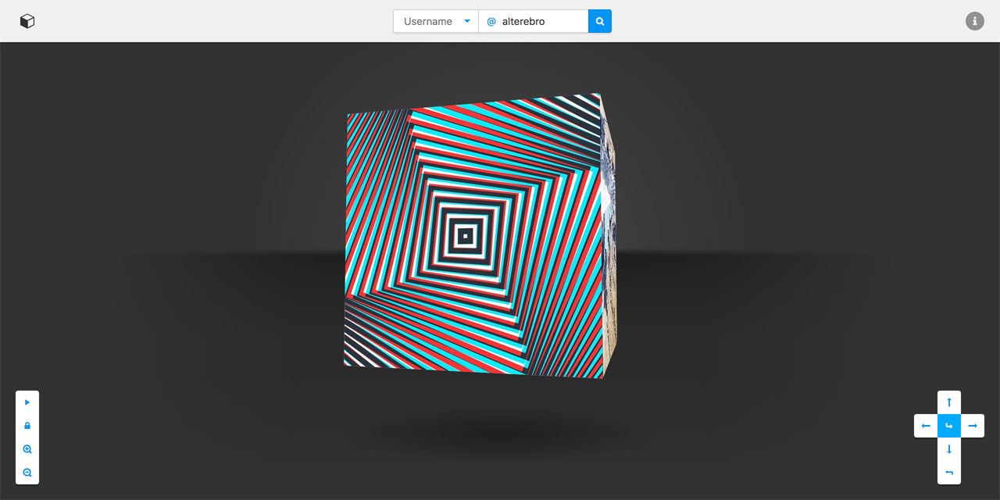

> ⚠️  _Instagram required authentication on its frontend long time ago making the InstaCube client-side scraping approach impossible. The cube UI itself still works, only the data source is gone. Kept here as a time capsule. Feel free to fork it if you want to plug in another data source._


# [InstaCube](https://moro.es/instacube/) (instagram-cube)

> Your Instagram feed in a cube!
> https://moro.es/instacube/

[](https://moro.es/instacube/)

---

### Install

```sh
$ git clone https://github.com/alterebro/instagram-cube.git
$ cd instagram-cube/
$ npm install
```

### Build

```sh
$ gulp build
# or: $ npm run build
```
This will create the `build` folder which is the one to upload

### Deploy

Open `upload-sample.sh`, set the variables to your own values, then rename it to `upload.sh` and give the file proper permissions (`chmod +x sync.sh`)

```sh
$ sh upload.sh test # dry-run flagged
$ sh upload.sh sync # rsyncs local copy to server

# equivalent to:
$ npm run deploy:test
$ npm run deploy:sync
```

---

*Jorge Moreno &mdash; [@alterebro](https://alterebro.com)*
